## About me

- Computer Science + Mathematics graduate, University of British Columbia (2026)
- Interested in where machine learning meets mathematical modelling: physics-informed learning, neural differential equations and data-driven discovery of governing equations
- Machine learning and deep learning for health and biology, and making models interpretable
- Artificial behavior intelligence and behavioral game AI (decision-making systems, goal-oriented action planning, finite-state machines), plus game design and computer graphics
- Building things from scratch in the open: an ML library (Python/C++) and a linear algebra library (C)
- Languages: English, French, Arabic

**Outside of code:** I love philosophy and zoology!

 

## Research interests

  

## Selected projects

  -A0AEC0?style=flat-square)

| Project | What it does | Stack | Status |
|---|---|---|:-:|
| **Epidemic waves PDE model** | Age-structured, opinion-driven prophylaxis model of COVID-19 waves using contact matrices and age-specific fatality rates | Python, NumPy |  |
| **Jersey number recognition** | Broadcast soccer pipeline: image restoration, pose-based torso crops, OCR/VLM ensemble with calibrated voting | PyTorch, YOLOv8 |  |
| **ML from scratch** | Classical ML algorithms behind a shared fit/predict API, validated against scikit-learn | Python, C++ |  |
| **Linear algebra in C** | Matrix library with manual memory management; naive vs cache-blocked multiplication | C |  |

<b>More projects</b>

 

| Project | What it does | Stack | Status |
|---|---|---|:-:|
| **Live lecture Q&A** | Real-time question answering over lecture speech and board content with tiered retrieval memory | Python, pgvector |  |
| **Password analysis** | Character trigram grader and inverse generator built on 174.8M leaked passwords, tested with Hashcat | Python |  |
| **Toronto safety analysis** | Neighbourhood safety scores and LightGBM crime/collision forecasts, served through a web app | PostgreSQL, LightGBM, FastAPI, Next.js |  |
| **Brownian motion notes** | Expository report on Lévy's construction and path properties | LaTeX |  |

<table>
<tr>
<td width="50%" valign="top">

## Tech stack

  

<b>Every tool, with links</b>

 

**Languages**

**Machine learning and deep learning**

**Data and engineering**

<b>Currently studying</b>

  
  
  
  

</td>
<td width="50%" valign="top">

## Contributions

  

<b>Publications</b>

 

- J. Wu, A. P. Herlihy, A. S. Mirza, **A. Afoud**, F. Fard. *GrowthHacker.* ACM TOSEM, 2026. [DOI](https://doi.org/10.1145/3815588)
- **A. Afoud**, J. Wu. *VReAct.* JAWs @ IEEE/ACM ASE 2026. [arXiv](https://arxiv.org/abs/2609.31937)

</td>
</tr>
</table>

---

  
   
  Hello World!
  

