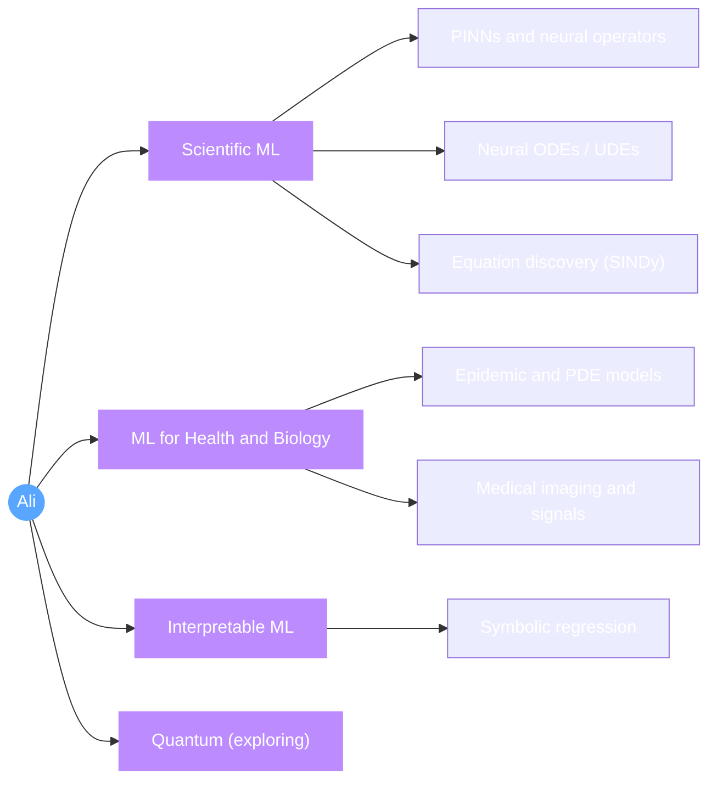

## About me

- Computer Science + Mathematics graduate, University of British Columbia (2026)
- Interested in where machine learning meets mathematical modelling: physics-informed learning, neural differential equations and data-driven discovery of governing equations
- Drawn to ML for medicine and biology, PDE models of epidemics, and quantum computing
- Building things from scratch in the open: an ML library (Python/C++) and a linear algebra library (C)
- Languages: English, French, Arabic
- Fun fact: 

 

## What I work on

<b>The equations behind it</b>

 

**Physics-informed loss**: fit the data while penalising violations of the governing PDE

$$\mathcal{L}(\theta) = \mathcal{L}_{\text{data}}(\theta) + \lambda \, \big\| \mathcal{N}[u_\theta] \big\|^2$$

**Neural ODE**: let a network define the dynamics

$$\frac{dh}{dt} = f_\theta(h, t)$$

**SINDy**: find the few library terms that explain the data

$$\dot{X} = \Theta(X)\, \Xi, \qquad \Xi \text{ sparse}$$

## Selected projects

  -555?style=flat-square)

| Project | What it does | Stack | Status |
|---|---|---|:-:|
| **Epidemic waves PDE model** | Age-structured, opinion-driven prophylaxis model of COVID-19 waves using contact matrices and age-specific fatality rates | Python, NumPy |  |
| **Jersey number recognition** | Broadcast soccer pipeline: image restoration, pose-based torso crops, OCR/VLM ensemble with calibrated voting | PyTorch, YOLOv8 |  |
| **ML from scratch** | Classical ML algorithms behind a shared fit/predict API, validated against scikit-learn | Python, C++ |  |
| **Linear algebra in C** | Matrix library with manual memory management; naive vs cache-blocked multiplication | C |  |

<b>More projects</b>

 

| Project | What it does | Stack | Status |
|---|---|---|:-:|
| **Live lecture Q&A** | Real-time question answering over lecture speech and board content with tiered retrieval memory | Python, pgvector |  |
| **Password analysis** | Character trigram grader and inverse generator built on 174.8M leaked passwords, tested with Hashcat | Python |  |
| **Toronto safety analysis** | Neighbourhood safety scores and LightGBM crime/collision forecasts, served through a web app | PostgreSQL, LightGBM, FastAPI, Next.js |  |
| **Brownian motion notes** | Expository report on Lévy's construction and path properties | LaTeX |  |

## Roadmap

- [ ] `ml-from-scratch`: classical ML library with C++ kernels
- [ ] `linalg-c`: matrix library and benchmarks
- [ ] `sindy-lorenz`: recover the Lorenz system with SINDy and PySR, then try noisy real data
- [ ] `pinn-vs-fno`: physics-informed network vs Fourier Neural Operator on a PDEBench problem
- [ ] `ude-epidemics`: universal differential equation for epidemic data, building on my PDE work
- [ ] Kaggle: late submission to LEAP ClimSim (hybrid physics-ML)
- [ ] Biomedical: PhysioNet Challenge entry
- [ ] Quantum: Qiskit notebooks

<b>Publications</b>

 

- J. Wu, A. P. Herlihy, A. S. Mirza, **A. Afoud**, F. Fard. *GrowthHacker.* ACM TOSEM, 2026. [DOI](https://doi.org/10.1145/3815588)
- **A. Afoud**, J. Wu. *VReAct.* JAWs @ IEEE/ACM ASE 2026. [arXiv](https://arxiv.org/abs/2609.31937)

## Tech stack

  

<b>Currently learning</b>

  
  
  
  

## Activity

  

  <picture>
    <source media="(prefers-color-scheme: dark)" srcset="https://raw.githubusercontent.com/Li11z/Li11z/output/github-snake-dark.svg" />
    
  </picture>

  
   
  Hello World!
  

